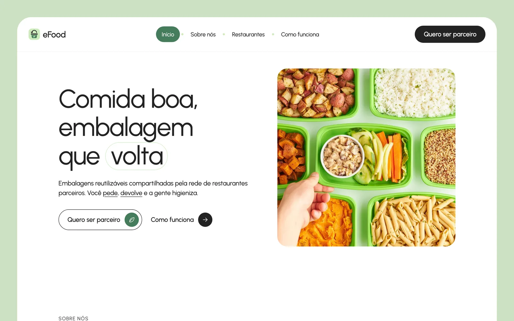
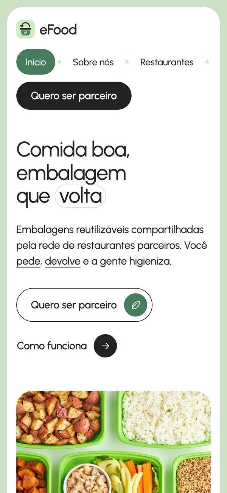

# eFood

**Comida boa, embalagem que volta.** Site da eFood, um serviço de embalagens reutilizáveis compartilhadas por uma rede de cafés e restaurantes parceiros, para que a comida para viagem deixe de gerar lixo descartável.



<p align="center">
  
</p>

## O que é a eFood

Toda refeição para viagem costuma sair numa embalagem de uso único que vai para o lixo minutos depois. A eFood troca essas embalagens por versões reutilizáveis equivalentes, escolhidas por higiene, segurança e durabilidade, e que circulam pela rede de restaurantes que já existe.

1. **Peça:** o cliente compra no restaurante parceiro e recebe a refeição numa embalagem durável.
2. **Devolva:** ele leva a embalagem a qualquer café ou restaurante da rede e ganha desconto na próxima compra.
3. **Higienizamos:** a eFood limpa a embalagem e a devolve ao ciclo, no lugar de mais um descartável.

O restaurante parceiro paga só um valor mensal pelo compartilhamento das embalagens e passa a ser reconhecido pelo cuidado com o que entrega ao cliente.

## O que tem no site

É uma landing page de uma página só, em português, feita para apresentar a ideia e trazer restaurantes parceiros:

- **Início:** a proposta da eFood em uma frase e os caminhos para "Quero ser parceiro" e "Como funciona".
- **Sobre nós:** por que devolver é melhor que reciclar.
- **Restaurantes ecológicos:** o que o restaurante ganha ao entrar na rede.
- **Como funciona:** os três passos do ciclo da embalagem.
- **Enquete:** uma pergunta rápida para quem visita sobre usar embalagens retornáveis.
- **Seja parceiro:** formulário de contato para restaurantes, com validação de nome e e-mail.

O cabeçalho fica fixo no desktop, e o layout se adapta do celular (a partir de 320px) até telas largas.

## Tecnologias

- [Next.js 16](https://nextjs.org/) (App Router) e React 19, em TypeScript
- CSS Modules com design tokens próprios (cores, tipografia, espaçamento) e a fonte Urbanist
- [Storybook 10](https://storybook.js.org/) para documentar os componentes
- [Vitest](https://vitest.dev/) e Testing Library para os testes
- Imagens em WebP e logo em SVG

## Como rodar

Pré-requisito: Node.js 20.9 ou mais recente.

```bash
npm install
npm run dev
```

O site abre em http://localhost:3000.

| Comando | O que faz |
|---|---|
| `npm run dev` | Servidor de desenvolvimento em http://localhost:3000. |
| `npm run build` / `npm start` | Build de produção e servidor. |
| `npm test` | Testes (Vitest + Testing Library). |
| `npm run storybook` | Storybook em http://localhost:6006. |
| `npm run build-storybook` | Storybook estático em `storybook-static/`. |

## Estrutura

```
app/                  página, layout e estilos globais (Next.js App Router)
components/landing/   seções da landing, uma por arquivo
design-system/        tokens, componentes, Storybook e o guia de uso
public/img/           logo (SVG) e imagens (WebP)
docs/                 referência visual, plano do design system e prints
```

## Design system

Todas as telas são montadas com os componentes de `design-system/`. Antes de criar ou mudar uma tela, leia o guia: [design-system/README.md](design-system/README.md). O mesmo guia abre como **Introdução** no Storybook, junto com as páginas de cores, tipografia e espaçamento.

## Créditos das imagens

As fotos são do [Pexels](https://www.pexels.com/), usadas sob a licença do Pexels:

- [Containers with Prepared Food](https://www.pexels.com/photo/containers-with-prepared-food-4929705/), de Justin Doherty
- [Food in Net Bags](https://www.pexels.com/photo/food-in-net-bags-5852201/), de Karola G
- [Hanging Plants Inside a Restaurant](https://www.pexels.com/photo/hanging-plants-inside-a-restaurant-5531035/), de Rachel Claire

## Deploy (Vercel)

O site é publicado no [Vercel](https://vercel.com/) pelo GitHub Actions ([.github/workflows/vercel.yml](.github/workflows/vercel.yml)). Cada execução roda testes, checagem de tipos e build, e só publica se tudo passar:

| Evento | Deploy |
|---|---|
| push na `main` | produção |
| push na `develop` | preview |
| pull request para `main` ou `develop` | preview do PR |

O deploy automático do Vercel pelo Git fica desligado no [vercel.json](vercel.json), para que nada seja publicado sem passar pelos testes.

**Configuração (uma vez só):**

1. Crie o projeto no Vercel e vincule a pasta: `npx vercel link`. Isso gera `.vercel/project.json` (já ignorado pelo Git) com `orgId` e `projectId`.
2. Crie um token em [vercel.com/account/tokens](https://vercel.com/account/tokens).
3. No GitHub, em **Settings → Secrets and variables → Actions**, cadastre três segredos: `VERCEL_TOKEN`, `VERCEL_ORG_ID` (o `orgId`) e `VERCEL_PROJECT_ID` (o `projectId`).

## Fluxo de branches (gitflow)

- `main`: o que está publicado. Cada versão ganha uma tag (`v1.0.0`, …).
- `develop`: integração; toda feature nasce e volta para cá.
- `feature/<nome>` e `fix/<nome>`: uma branch por trabalho, criada a partir de `develop` e integrada com `git merge --no-ff`.
- `release/<versão>`: sai de `develop` quando a versão está pronta e entra na `main` com uma tag.

```bash
git checkout develop
git checkout -b feature/minha-feature
# … commits …
git checkout develop
git merge --no-ff feature/minha-feature
```
